<p align="center">
    
</p>

<h1 align="center">MACMA.pl</h1>

<p align="center">
  <strong>Promotional products and e-commerce platform</strong>
</p>

<p align="center">
  MACMA.pl is a modern online store and digital commerce platform designed for promotional products, branded merchandise, and business-oriented product configuration. The project combines a responsive storefront, catalog management, order workflow, account features, and customization tools in a single system.
</p>

## Overview

MACMA.pl was developed as a full-featured e-commerce solution for businesses and customers looking to browse, order, customize, and manage promotional products efficiently. The platform supports product discovery, negotiation, dashboard management, configurators, and content-driven marketing workflows.

## Features

- **Product catalog**: Browse and search promotional products by category and assortment.
- **Shopping cart and checkout**: Multi-step ordering flow with delivery options and threshold-based shipping logic.
- **User accounts**: Registration, login, and personalized customer dashboard.
- **Custom configurators**: Product personalization tools for branding, USB setup, shop creation, and custom presentation.
- **Pricing calculator**: Interactive pricing and offer estimation features.
- **Administration dashboard**: Access to orders, catalogs, offers, addresses, marketing content, negotiations, newsletters, API features, and data management.
- **Content publishing**: Blog, news, FAQ, and newsletter modules.
- **Support and contact tools**: Contact forms, contact management, and internal negotiation workflows.
- **Responsive design**: Optimized experience for desktop and mobile devices.

## Technologies

The project is built with a combination of modern web technologies and established frontend/backend tools:

- PHP
- HTML5
- SCSS
- Bootstrap 5.3.2
- JavaScript
- jQuery
- Bootbox.js
- Swiper.js 11.1.1
- Lightbox.js
- magnific-popup.js 1.1.0
- Select2
- MySQL (where applicable)

## Requirements

### Prerequisites

- PHP 7.4 or higher
- MySQL 5.7 or higher (if database functionality is used)
- Apache or Nginx web server
- XAMPP or equivalent local environment recommended for Windows development

### Local setup

1. Clone or download this repository.
2. Place the project folder in your local web server root directory, for example `htdocs` in XAMPP.
3. Start the web server and database services.
4. Import the required SQL schema if database support is enabled.
5. Open the application in a browser using `http://localhost/MACMA` or your local server URL.

## Usage

- **Browse catalog**: Explore featured products, categories, and special offers.
- **Place an order**: Add products to the cart, select shipping options, and proceed to checkout.
- **Manage account**: Access a dashboard for orders, preferences, and custom project data.
- **Customize products**: Use configurators for branding and promotional item setup.
- **Read content**: Review news, articles, blogs, and newsletters.

## Project structure

```text
MACMA/
├── assets/                 # Static assets (images, icons)
│   ├── icons/
│   └── img/
├── components/             # Reusable PHP components
│   ├── blog/
│   ├── branding_page/
│   ├── calculator/
│   ├── cart/
│   ├── catalogs/
│   ├── category/
│   ├── common/
│   ├── contact/
│   ├── dashboard/
│   ├── e_leaflet/
│   ├── faq/
│   ├── import_page/
│   ├── main_page/
│   ├── negotiator/
│   ├── news/
│   ├── news_article/
│   ├── newsletter/
│   ├── offertspage/
│   ├── product_card/
│   ├── register/
│   ├── shop_creator/
│   └── usb_configurator/
├── css/                    # Compiled CSS assets
├── js/                     # JavaScript libraries and application scripts
├── scss/                   # SCSS source files
├── screenshots/            # Product screenshots
├── gif/                    # Demo GIFs
├── *.php                   # Main application pages
├── LICENSE.md
└── README.md
```

## Live links

| Page | URL |
| --- | --- |
| Home page | https://macma.pl/ |
| Import | https://macma.pl/import/ |
| Catalogs | https://macma.pl/katalogi/ |
| Branding | https://macma.pl/znakowanie/ |
| New products | https://macma.pl/nowosci/ |
| Category page (events) | https://macma.pl/oferta/eventy/ |
| About us | https://macma.pl/strony/o-nas/ |
| Newsletter | https://macma.pl/newsletter/ |
| News | https://macma.pl/aktualnosci/ |
| News article | https://macma.pl/aktualnosci/3,techniki-znakowania-nie-musisz-byc-ekspertem/ |
| Blog | https://macma.pl/blog/ |
| Blog article | https://macma.pl/blog/1,najczestsze-problemy-z-ktorymi-mierza-sie-agencje-reklamowe-podczas-zamawiania-gadzetow-promocyjnych/ |
| FAQ | https://macma.pl/faq/ |
| Contact | https://macma.pl/kontakt/ |
| Product page | https://macma.pl/940,okulary-przeciwsloneczne-uv400-ferraghini-f24003-14-5-x-15-x-5-5-cm/ |
| 404 page | https://macma.pl/fsdfdsfsd |
| Login / profile | https://macma.pl/profile/ |

## Architecture

<p align="center">
  
</p>

## Screenshots

Each screenshot shows the desktop layout with the mobile view in the frame on the right :desktop_computer: :iphone:. Click an image to open it at full size.

### Storefront & content

<table>
  <tr>
    <td align="center" width="50%">
      <a href="./screenshots/macma_screenshot_01.jpg"></a><br />
      <b>Home page</b><br />
      <sub>Hero slider, key benefits and new arrivals</sub>
    </td>
    <td align="center" width="50%">
      <a href="./screenshots/macma_screenshot_02.jpg"></a><br />
      <b>Branding</b><br />
      <sub>Branding services overview with embedded video</sub>
    </td>
  </tr>
  <tr>
    <td align="center" width="50%">
      <a href="./screenshots/macma_screenshot_03.jpg"></a><br />
      <b>Import</b><br />
      <sub>Direct Asia import service landing page</sub>
    </td>
    <td align="center" width="50%">
      <a href="./screenshots/macma_screenshot_04.jpg"></a><br />
      <b>Branding lead times</b><br />
      <sub>Current branding deadlines for each technique</sub>
    </td>
  </tr>
  <tr>
    <td align="center" width="50%">
      <a href="./screenshots/macma_screenshot_06.jpg"></a><br />
      <b>News</b><br />
      <sub>News listing with article cards</sub>
    </td>
    <td align="center" width="50%">
      <a href="./screenshots/macma_screenshot_07.jpg"></a><br />
      <b>News article</b><br />
      <sub>Single article view with hero image</sub>
    </td>
  </tr>
  <tr>
    <td align="center" width="50%">
      <a href="./screenshots/macma_screenshot_08.jpg"></a><br />
      <b>Blog</b><br />
      <sub>Latest blog posts</sub>
    </td>
    <td align="center" width="50%">
      <a href="./screenshots/macma_screenshot_09.jpg">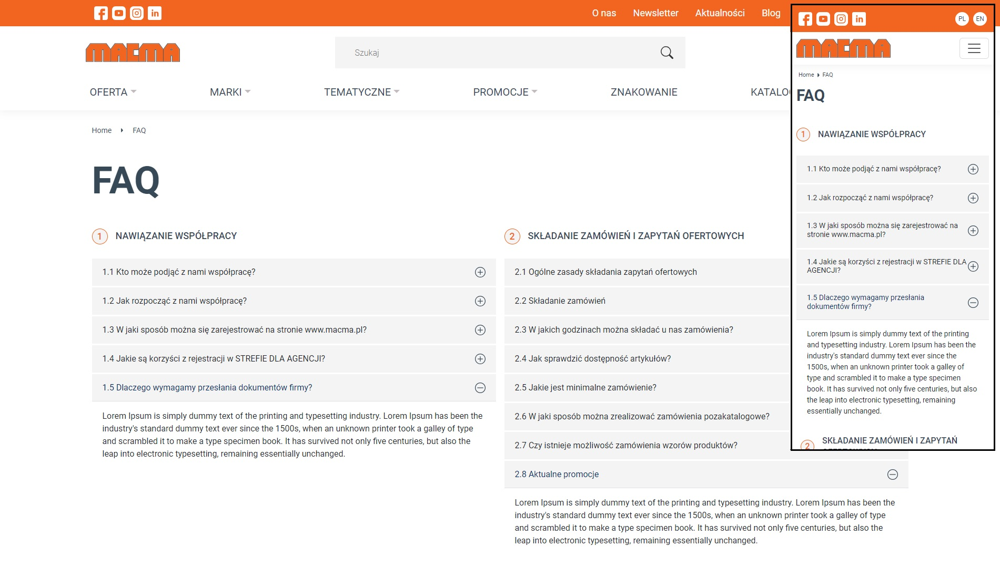</a><br />
      <b>FAQ</b><br />
      <sub>Accordion FAQ grouped by topic</sub>
    </td>
  </tr>
  <tr>
    <td align="center" width="50%">
      <a href="./screenshots/macma_screenshot_05.jpg"></a><br />
      <b>Newsletter</b><br />
      <sub>Sign-up form with email validation</sub>
    </td>
    <td align="center" width="50%">
      <a href="./screenshots/macma_screenshot_17.jpg"></a><br />
      <b>Contact</b><br />
      <sub>Company details, map, departments and contact form</sub>
    </td>
  </tr>
</table>

### Shopping & ordering

<table>
  <tr>
    <td align="center" width="50%">
      <a href="./screenshots/macma_screenshot_43.jpg"></a><br />
      <b>Category page</b><br />
      <sub>Product grid with category menu, filters and sorting</sub>
    </td>
    <td align="center" width="50%">
      <a href="./screenshots/macma_screenshot_10.jpg"></a><br />
      <b>Product page</b><br />
      <sub>Product details, colour variants, pricing and quick actions</sub>
    </td>
  </tr>
  <tr>
    <td align="center" width="50%">
      <a href="./screenshots/macma_screenshot_16.jpg">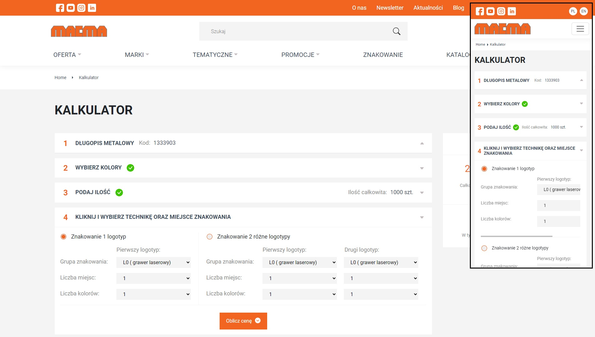</a><br />
      <b>Pricing calculator</b><br />
      <sub>Step-by-step price calculation for branded products</sub>
    </td>
    <td align="center" width="50%">
      <a href="./screenshots/macma_screenshot_44.jpg">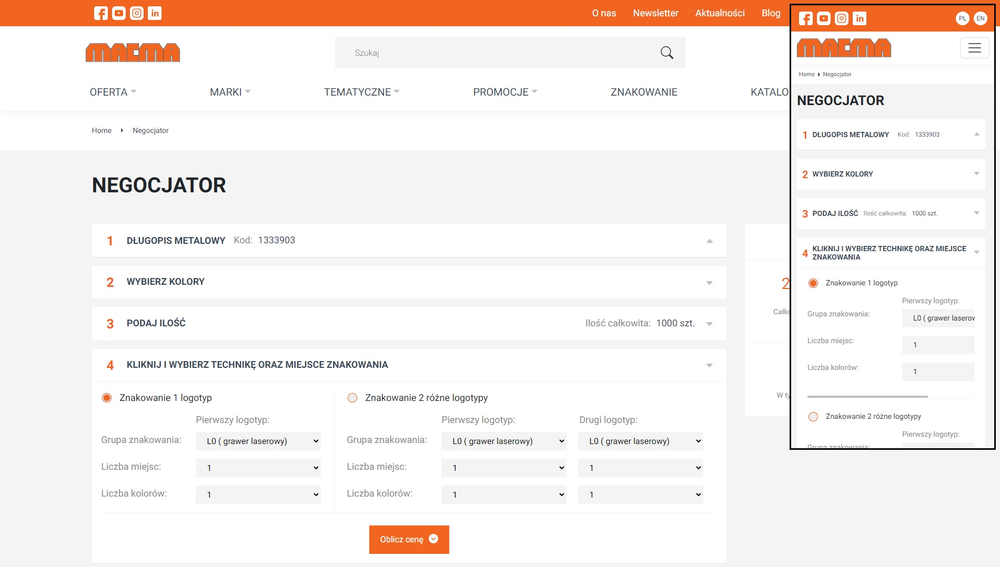</a><br />
      <b>Price negotiator</b><br />
      <sub>Request a custom price for a selected product</sub>
    </td>
  </tr>
  <tr>
    <td align="center" width="50%">
      <a href="./screenshots/macma_screenshot_11.jpg"></a><br />
      <b>Cart – Step 1: Products</b><br />
      <sub>Cart table with quantities, discounts and totals</sub>
    </td>
    <td align="center" width="50%">
      <a href="./screenshots/macma_screenshot_12.jpg"></a><br />
      <b>Cart – Step 2: Branding</b><br />
      <sub>Branding technique selection and logo upload</sub>
    </td>
  </tr>
  <tr>
    <td align="center" width="50%">
      <a href="./screenshots/macma_screenshot_13.jpg">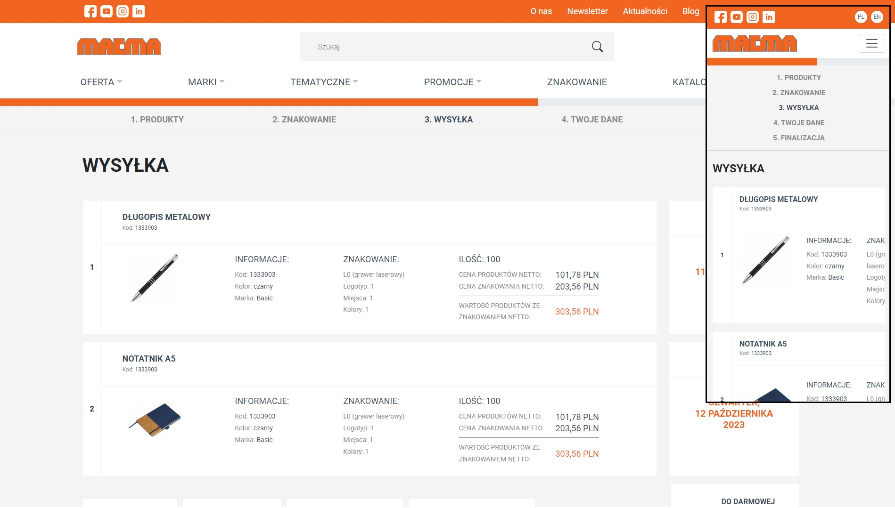</a><br />
      <b>Cart – Step 3: Shipping</b><br />
      <sub>Order summary with branding costs and delivery date</sub>
    </td>
    <td align="center" width="50%">
      <a href="./screenshots/macma_screenshot_14.jpg"></a><br />
      <b>Cart – Step 4: Your details</b><br />
      <sub>Billing, contact and shipping address forms</sub>
    </td>
  </tr>
  <tr>
    <td align="center" width="50%">
      <a href="./screenshots/macma_screenshot_15.jpg">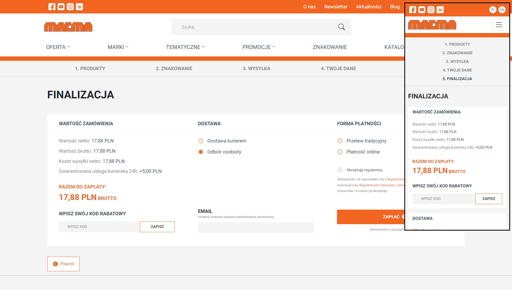</a><br />
      <b>Cart – Step 5: Checkout</b><br />
      <sub>Order total, delivery option, payment method and discount code</sub>
    </td>
    <td width="50%"></td>
  </tr>
</table>

### Registration & customer dashboard

<table>
  <tr>
    <td align="center" width="50%">
      <a href="./screenshots/macma_screenshot_45.jpg"></a><br />
      <b>Registration</b><br />
      <sub>Sign-up for new and existing customers</sub>
    </td>
    <td align="center" width="50%">
      <a href="./screenshots/macma_screenshot_46.jpg">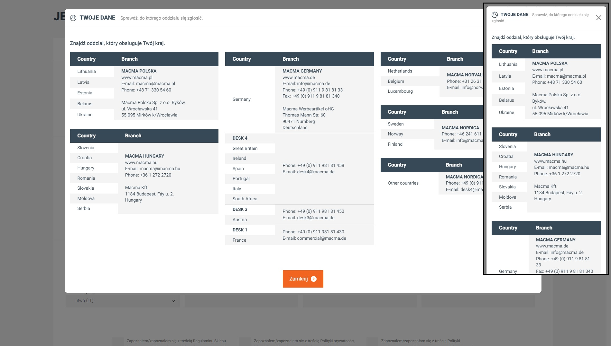</a><br />
      <b>Registration – branch finder</b><br />
      <sub>Modal listing Macma branches by country</sub>
    </td>
  </tr>
  <tr>
    <td align="center" width="50%">
      <a href="./screenshots/macma_screenshot_18.jpg"></a><br />
      <b>Dashboard</b><br />
      <sub>Credit line, customer status, discounts and account manager</sub>
    </td>
    <td align="center" width="50%">
      <a href="./screenshots/macma_screenshot_19.jpg"></a><br />
      <b>Dashboard – Your details</b><br />
      <sub>Personal and company data form</sub>
    </td>
  </tr>
  <tr>
    <td align="center" width="50%">
      <a href="./screenshots/macma_screenshot_20.jpg">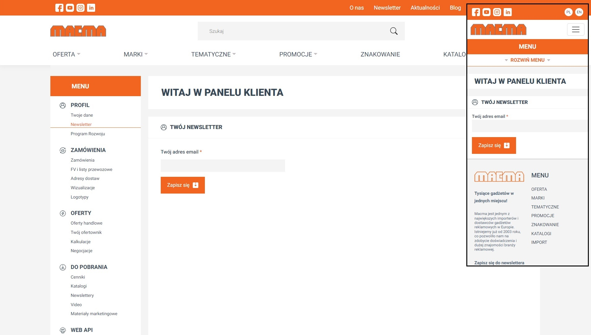</a><br />
      <b>Dashboard – Newsletter</b><br />
      <sub>Newsletter subscription settings</sub>
    </td>
    <td align="center" width="50%">
      <a href="./screenshots/macma_screenshot_21.jpg"></a><br />
      <b>Dashboard – Loyalty program</b><br />
      <sub>Customer tier progress and program benefits</sub>
    </td>
  </tr>
  <tr>
    <td align="center" width="50%">
      <a href="./screenshots/macma_screenshot_22.jpg"></a><br />
      <b>Dashboard – Orders</b><br />
      <sub>Order history with status tracking</sub>
    </td>
    <td align="center" width="50%">
      <a href="./screenshots/macma_screenshot_23.jpg"></a><br />
      <b>Dashboard – Invoices &amp; waybills</b><br />
      <sub>Invoices with payment status and downloads</sub>
    </td>
  </tr>
  <tr>
    <td align="center" width="50%">
      <a href="./screenshots/macma_screenshot_24.jpg"></a><br />
      <b>Dashboard – Delivery addresses</b><br />
      <sub>Saved delivery addresses management</sub>
    </td>
    <td align="center" width="50%">
      <a href="./screenshots/macma_screenshot_25.jpg"></a><br />
      <b>Dashboard – Visualizations</b><br />
      <sub>Downloadable product visualizations</sub>
    </td>
  </tr>
  <tr>
    <td align="center" width="50%">
      <a href="./screenshots/macma_screenshot_26.jpg"></a><br />
      <b>Dashboard – Logos</b><br />
      <sub>Uploaded logo library with drag &amp; drop upload</sub>
    </td>
    <td align="center" width="50%">
      <a href="./screenshots/macma_screenshot_27.jpg"></a><br />
      <b>Dashboard – Commercial offers</b><br />
      <sub>Offers prepared for the customer</sub>
    </td>
  </tr>
  <tr>
    <td align="center" width="50%">
      <a href="./screenshots/macma_screenshot_28.jpg"></a><br />
      <b>Dashboard – Your offers</b><br />
      <sub>Offers created in the offer builder</sub>
    </td>
    <td align="center" width="50%">
      <a href="./screenshots/macma_screenshot_29.jpg">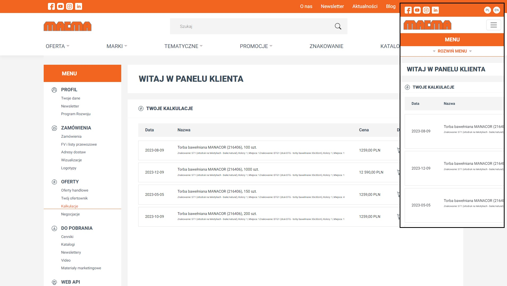</a><br />
      <b>Dashboard – Calculations</b><br />
      <sub>Saved price calculations</sub>
    </td>
  </tr>
  <tr>
    <td align="center" width="50%">
      <a href="./screenshots/macma_screenshot_30.jpg"></a><br />
      <b>Dashboard – Negotiations</b><br />
      <sub>Price negotiation history</sub>
    </td>
    <td align="center" width="50%">
      <a href="./screenshots/macma_screenshot_31.jpg">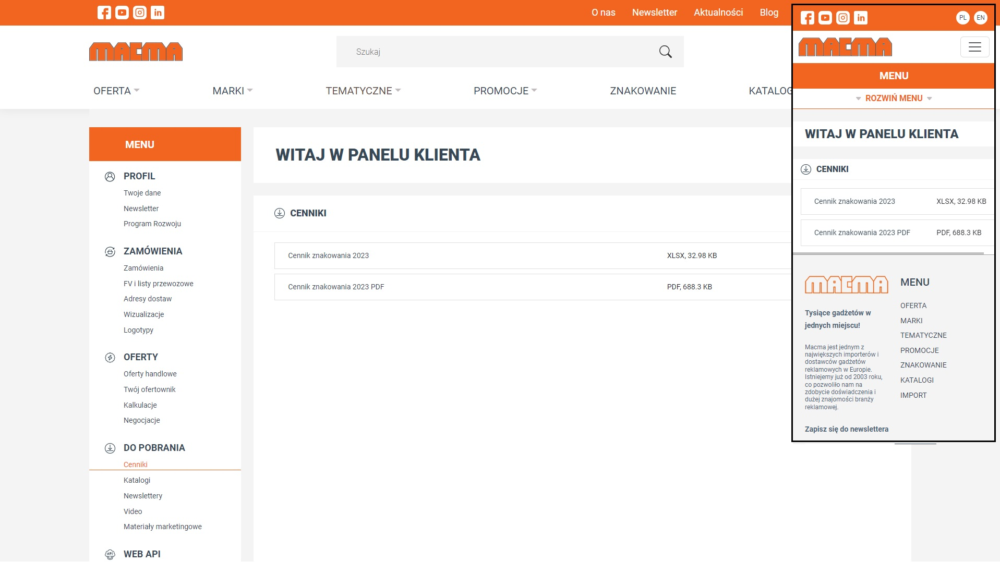</a><br />
      <b>Dashboard – Price lists</b><br />
      <sub>Downloadable price lists (XLSX / PDF)</sub>
    </td>
  </tr>
  <tr>
    <td align="center" width="50%">
      <a href="./screenshots/macma_screenshot_32.jpg">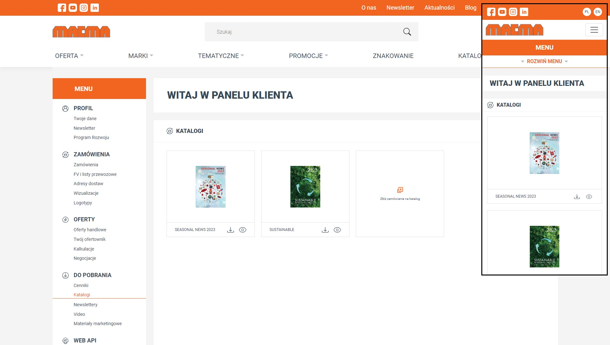</a><br />
      <b>Dashboard – Catalogs</b><br />
      <sub>Product catalogs to download or preview</sub>
    </td>
    <td align="center" width="50%">
      <a href="./screenshots/macma_screenshot_33.jpg"></a><br />
      <b>Dashboard – Newsletters</b><br />
      <sub>Newsletter archive</sub>
    </td>
  </tr>
  <tr>
    <td align="center" width="50%">
      <a href="./screenshots/macma_screenshot_34.jpg"></a><br />
      <b>Dashboard – Videos</b><br />
      <sub>Video library</sub>
    </td>
    <td align="center" width="50%">
      <a href="./screenshots/macma_screenshot_35.jpg"></a><br />
      <b>Dashboard – Marketing materials</b><br />
      <sub>Brand assets to download</sub>
    </td>
  </tr>
  <tr>
    <td align="center" width="50%">
      <a href="./screenshots/macma_screenshot_36.jpg"></a><br />
      <b>Dashboard – Web API</b><br />
      <sub>Product data feed in XML, CSV, JSON and TXT</sub>
    </td>
    <td width="50%"></td>
  </tr>
</table>

### Offer builder

<table>
  <tr>
    <td align="center" width="50%">
      <a href="./screenshots/macma_screenshot_37.jpg">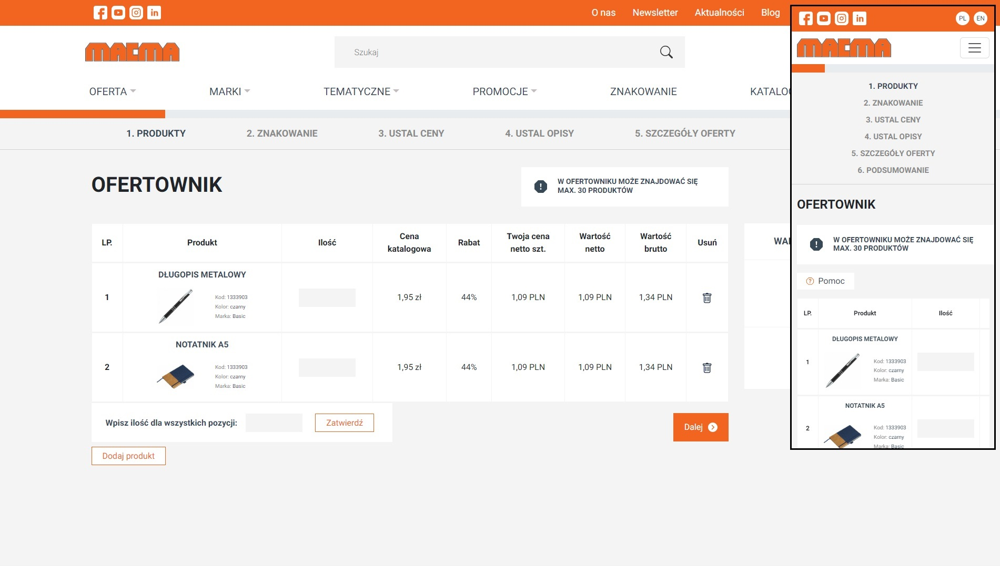</a><br />
      <b>Offer builder – Step 1: Products</b><br />
      <sub>Select products and quantities (up to 30 items)</sub>
    </td>
    <td align="center" width="50%">
      <a href="./screenshots/macma_screenshot_38.jpg"></a><br />
      <b>Offer builder – Step 2: Branding</b><br />
      <sub>Branding options and logo upload per product</sub>
    </td>
  </tr>
  <tr>
    <td align="center" width="50%">
      <a href="./screenshots/macma_screenshot_39.jpg">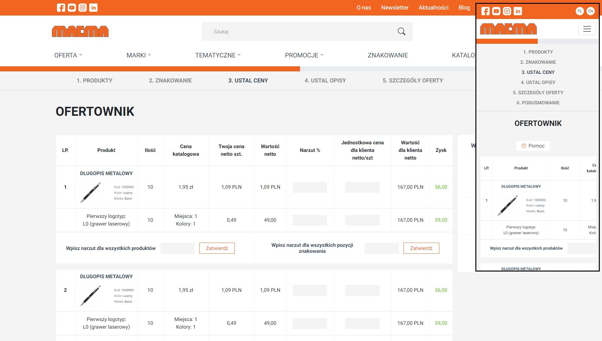</a><br />
      <b>Offer builder – Step 3: Pricing</b><br />
      <sub>Set markups and see profit per item</sub>
    </td>
    <td align="center" width="50%">
      <a href="./screenshots/macma_screenshot_40.jpg"></a><br />
      <b>Offer builder – Step 4: Descriptions</b><br />
      <sub>Edit names, codes and product specifications</sub>
    </td>
  </tr>
  <tr>
    <td align="center" width="50%">
      <a href="./screenshots/macma_screenshot_41.jpg">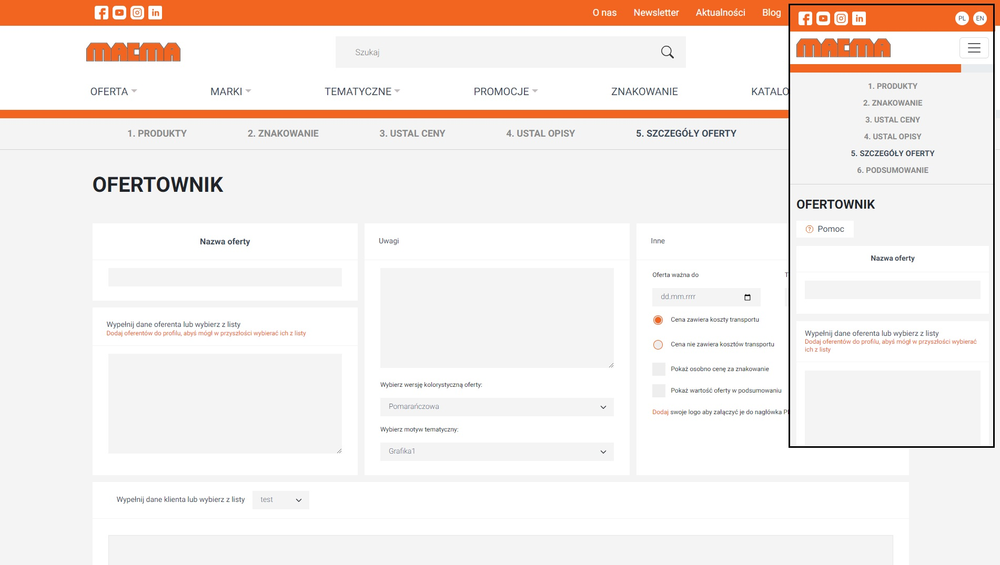</a><br />
      <b>Offer builder – Step 5: Offer details</b><br />
      <sub>Validity date, colour theme and client data</sub>
    </td>
    <td align="center" width="50%">
      <a href="./screenshots/macma_screenshot_42.jpg"></a><br />
      <b>Offer builder – Step 6: Summary</b><br />
      <sub>Export to PDF, print, send or convert into an order</sub>
    </td>
  </tr>
</table>

## GIF presentation

### Desktop website preview

Please wait for the GIF to load (approximately 39.7 MB).


### Mobile website preview

Please wait for the GIF to load (approximately 15.9 MB).


## License

Copyright © 2025. All rights reserved.

This project is the intellectual property of its author. It is not for commercial use. The author retains all copyright and ownership rights.

The following is strictly prohibited without the author's explicit written permission:

- copying the project or any part of it
- redistributing or sharing the source code
- modifying and publishing the code as your own
- using this project in any commercial, business, or profit-generating activity

This project is protected by copyright law and may not be reproduced, distributed, or used commercially without written authorization from the author.
